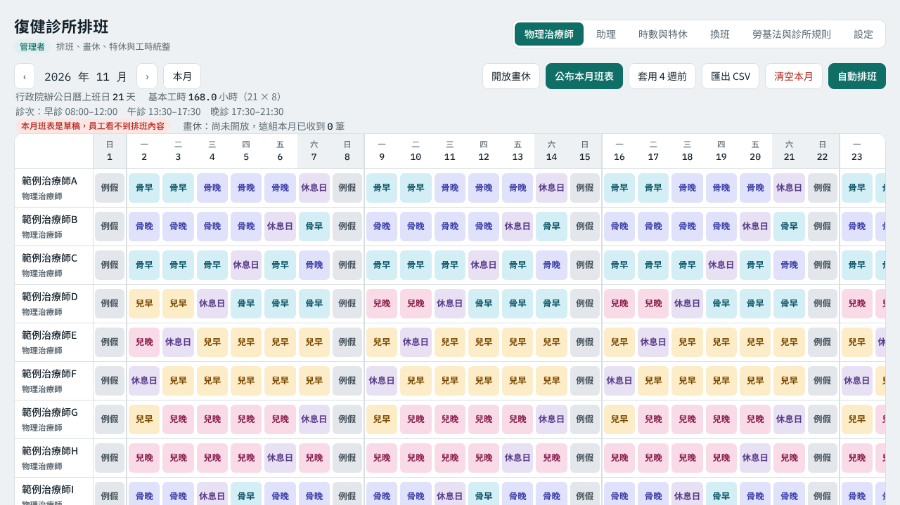
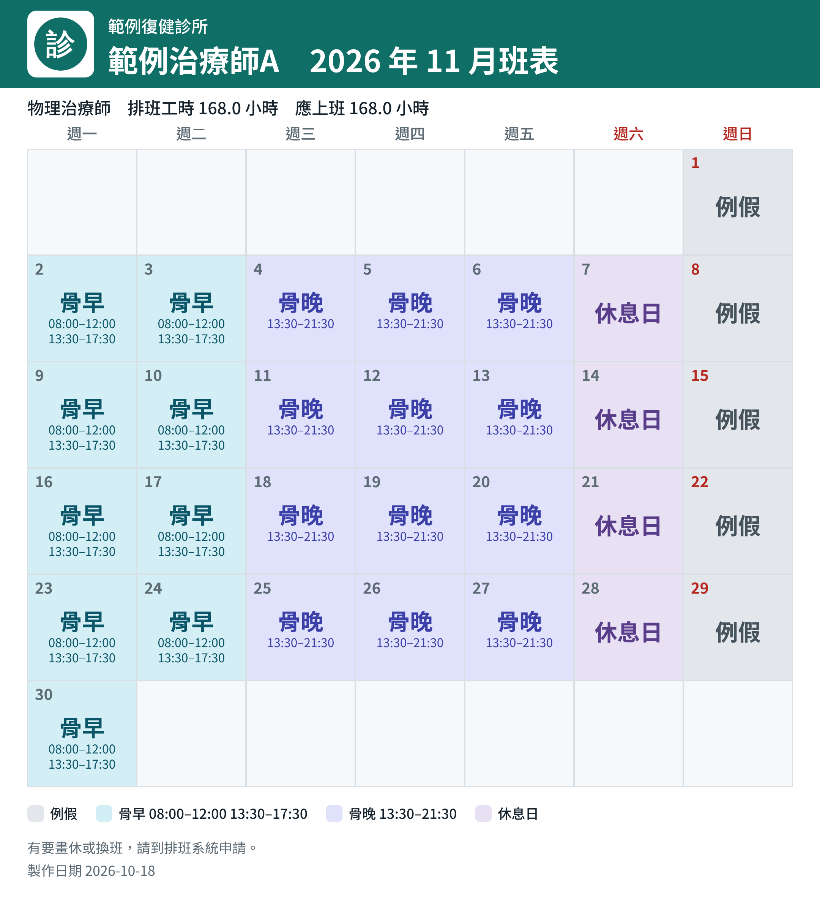

# 診所排班系統 Clinic Shift Scheduler

給診所（特別是復健科）使用的排班工具。純前端、不用建置，用 Chrome 或 Safari 開啟就能使用。
可以只存在瀏覽器裡單人試用，也可以接上 [Supabase](https://supabase.com) 讓員工用 email 驗證碼登入、自己畫休與換班。



## 功能

**排班**
- 物理治療師、助理分成兩個分頁。治療師依「科別 × 診次」排班，助理依診次時段（早／午／晚診的任意組合，或自訂時間）排班
- 診次、科別、各診次最低人數、班別與休假選項都可以在畫面上調整
- 自動排班：先補各診次缺額，再平均分配工時；優先照員工畫的休假、管理者設定的個人要求
- 一例一休、連續上班、兩班間隔 11 小時、週工時、單日工時等檢查，違規的格子會標紅
- 月工時依行政院人事行政總處辦公日曆（上班日 × 8 小時）統整，顯示到小數點後一位

**員工**
- 用 email 驗證碼登入，第一次登入要填手機、緊急聯絡人、地址，由管理者確認綁定
- 自己畫例假、休息日、特休、徒手日與其他假別（管理者決定開放哪些、每月上限）
- 換班：員工提出 → 對方同意 → 管理者核准，核准前會預演有沒有新增違規
- 班表可以先存成草稿，按「公布」後員工才看得到排班內容

**假別與特休**
- 特休依到職週年自動帶入（勞基法第 38 條），可以每人手動調整
- 病假、事假、婚假、喪假、公假、公傷病假、生理假、產假、產檢假、陪產假、家庭照顧假的法定天數與薪資當作預設值，全部可調整，也可以每人單獨調整
- 管理者專用的個人備註（固定休、不上的診次、偏好診次、每週最多上班天數、指定日期）

**通知**
- 產生每位員工的班表圖片（含診所名稱與 logo），下載或複製後用 LINE 傳送
- 班表總表圖片、LINE 分享文字、CSV 匯出



## 兩種模式

| | 本機模式（預設） | Supabase 模式 |
|---|---|---|
| 資料存在 | 這個瀏覽器的 localStorage | Supabase（Postgres） |
| 使用者 | 一個人（管理者） | 管理者＋多位員工，email 驗證碼登入 |
| 員工畫休、換班、個人資料 | 不支援 | 支援 |
| 需要 | 什麼都不用 | 一個免費的 Supabase 專案 |

### 快速開始（本機模式）

```bash
git clone https://github.com/1120yg-allen/first.git
cd first
npm run serve        # 或用任何靜態網站伺服器，然後開 http://localhost:8080
```

打開後按「建立初始設定並加入範例人員」就能試用。資料只在這個瀏覽器，換電腦前請先到「設定」匯出備份。

> 不建議直接雙擊 `index.html`（`file://`）：部分瀏覽器對本機檔案的限制比較多，Safari 尤其如此。

### 設定 Supabase 模式（讓員工登入）

1. 到 supabase.com 建立專案。
2. 在 **SQL Editor** 貼上並執行整份 [`supabase/schema.sql`](supabase/schema.sql)（可以重複執行）。
3. 在 **Authentication → Providers** 確認 **Email** 已啟用。
4. 在 **Authentication → Email Templates → Magic Link**，把內容改成會顯示驗證碼，例如：
   ```html
   <h2>排班系統登入驗證碼</h2>
   <p>請輸入這組驗證碼：<b>{{ .Token }}</b></p>
   ```
5. 在 SQL Editor 把自己設成管理者：
   ```sql
   insert into public.admins(email) values ('你的信箱@example.com');
   ```
6. 在 **Project Settings → API** 複製 `Project URL` 和 `anon public` key，填進 `config.js`：
   ```js
   window.APP_CONFIG = {
     mode: 'supabase',
     supabaseUrl: 'https://xxxx.supabase.co',
     supabaseKey: 'eyJ...',
     ...
   };
   ```
   anon key 設計上就是給前端用的，可以公開；資料的安全靠第 2 步的 Row Level Security。**不要**把 `service_role` key 放進來。
7. 用管理者信箱登入，到「設定 → 允許登入的 email」加入員工的信箱。員工登入後會自己認領姓名並填資料，你在「設定」按「確認綁定」後才能畫休。

> Supabase 內建的寄信服務有每小時寄信數量限制，正式使用請在 **Project Settings → Auth → SMTP** 設定自己的 SMTP。

### 部署到 GitHub Pages

1. 把 `config.js` 改好後 commit 到你自己的 fork。
2. Repository **Settings → Pages**，Source 選 `main` 分支、根目錄。
3. 在 Supabase **Authentication → URL Configuration** 把 Pages 的網址加進 Site URL。

員工用手機或電腦的 Chrome、Safari 開這個網址即可，不用安裝 App。如果是在 LINE 裡點開，請選「用瀏覽器開啟」。

## 瀏覽器支援

目標是 Chrome 與 Safari 最近的版本，不需要建置工具。目前的測試狀況：

- ✅ 排班邏輯、勞基法檢查、特休與假別計算：自動測試（`npm test`）
- ✅ Supabase 的權限規則：用 PGlite 跑 SQL 測試（`tests/rls.test.mjs`）。這是模擬環境，不是真的 Supabase 專案
- ✅ 畫面：在 Chromium 實際跑過本機模式
- ⚠️ **Safari 沒有實際測試過**，也沒有用真的 Supabase 專案端到端測過登入流程。遇到問題請開 issue
- 下載與複製圖片依賴瀏覽器的功能：Safari 複製圖片可能被擋，可以改用「下載圖片」

## 安全與隱私

- 員工個人資料（手機、緊急聯絡人、地址）和管理者備註存在只有管理者讀得到的路徑，規則寫在 `supabase/schema.sql`，用 `tests/rls.test.mjs` 測過
- 「公布班表」只是畫面上隱藏草稿；名單內的員工技術上仍可以從資料庫讀到班表
- 蒐集員工個人資料需要符合個人資料保護法（告知、目的、保存期限等），這是使用者自己的責任
- 勞基法與假別規則是整理後的預設值，不是法律意見；請以勞動部公告為準

## 不支援的事

這是純前端專案，沒有自己的伺服器，所以：
- 不能主動推播 LINE 或寄信。通知用「產生圖片／文字，你按一下傳出去」的方式
- 不能用 LINE 登入。登入只有 email 驗證碼
- 不支援變形工時、打卡、薪資計算

## 開發

```bash
npm install
npm test                       # 邏輯、Supabase 資料層（假用戶端）、SQL 權限
npm run serve                  # 本機開發
node tests/e2e-smoke.mjs       # 選用，需要 npx playwright install chromium
```

程式碼沒有建置步驟：`index.html` 載入 `src/` 底下的檔案。

```
index.html            頁面骨架
config.js             設定（模式、Supabase 金鑰、補充假日表）
styles.css            樣式（含深色模式）
src/app.js            畫面與排班邏輯
src/platform.js       選擇資料來源、瀏覽器下載
src/adapters/local.js       本機模式
src/adapters/supabase.js    Supabase 模式（email 驗證碼登入、資料層）
supabase/schema.sql   資料表與權限
docs/DATA-MODEL.md    資料結構
tests/                測試
```

### 辦公日曆

內建 2026 年行政院人事行政總處辦公日曆（平日放假日，2026 年沒有補班日）。其他年度請在 `config.js` 的 `holidays` 補上，或在班表頁點日期欄位手動標示。
這份內建資料是從公開整理的資料轉錄的，**請對照人事行政總處官網確認**。

## 預設值

預設的科別是「骨科」「小兒」，診次是 08:00–12:00、13:30–17:30、17:30–21:30，是照復健科診所的情境設定的。診次、科別、班別都能在「設定」頁改掉，不用改程式。

## English

A browser-based shift scheduler for clinics in Taiwan (rehab clinics in particular): per-department/session staffing, Taiwan Labor Standards Act checks (one fixed day off + one rest day per week, 11 h between shifts), statutory leave types, annual-leave calculation, employee self-service for leave requests and shift swaps, and shareable schedule images. Runs entirely in the browser (Chrome/Safari). Data lives in localStorage (single user) or in Supabase (multi-user, email OTP login, Row Level Security). No build step. UI is in Traditional Chinese. MIT licensed.

## 授權

[MIT](LICENSE)
